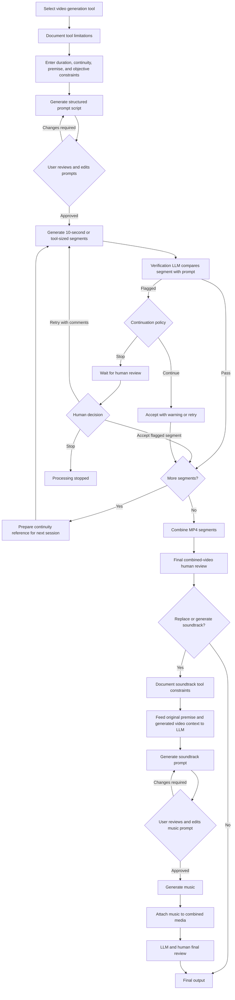

# Video Generation Workflow — Multi-Agent Orchestration

## 1. Purpose

This document describes the end-to-end workflow for generating, validating, combining, and optionally soundtracking a video using a selected external video-generation tool and/or API.

The workflow is designed to:

- Preserve continuity across multiple generation sessions.
- Respect the documented limitations of the selected generation tool.
- Keep the user in control of prompts and rejection decisions.
- Use an independent LLM to verify generated content against the prompt.
- Support human review at critical checkpoints.
- Produce a combined video and, optionally, a video with replacement or generated music.

## 2. Scope

The workflow covers:

1. Selection and limitation analysis of a video-generation tool.
2. Collection of user constraints, premises, and objectives.
3. Generation of structured prompting data.
4. User editing and approval.
5. Segment-by-segment video generation.
6. Automated and human correctness review.
7. Final segment concatenation.
8. Optional soundtrack generation.
9. Music attachment and final review.

It does not prescribe a specific video-generation provider or user interface implementation.

## 3. Actors and Components

| Actor or component | Responsibility |
|---|---|
| User | Selects tools, supplies premises and constraints, edits prompts, resolves flagged outputs, and approves checkpoints. |
| Video Generation Tool | Generates video segments according to provider-specific API or interface requirements. |
| Video Generation Orchestrator | Splits work into permitted generation sessions and segments, maintains continuity, submits prompts, and handles outputs. |
| Prompt Script Generator | Converts user inputs and tool constraints into an approved prompt sequence. |
| Verification LLM | Independently compares a generated segment or frame sequence with the applicable prompt and acceptance criteria. |
| Human Reviewer | Reviews generated segments, final media, and soundtrack where human-in-the-loop approval is required. |
| Music Generation Tool | Generates optional background music or soundtrack according to provider-specific constraints. |
| Media Processing Script | Combines MP4 segments and replaces or adds the soundtrack. |
| Final Review LLM | Reviews the combined media and/or soundtrack against the original premise, prompt, and constraints. |

## 4. Primary Workflow

## 5. Detailed Flow

### 5.1 Select Video Generation Tool and Record Limitations

The user selects a video-generation tool or API.

The system records provider-specific metadata, including:

- Maximum generated duration per request.
- Maximum total duration or number of requests.
- Supported aspect ratios and resolutions.
- Maximum and minimum prompt lengths.
- Input types accepted, such as text, image, audio, or existing video.
- Whether an end frame, first frame, reference image, or previous segment can be supplied.
- API, credit, rate, quota, and cost constraints.
- Supported video and audio formats.
- Whether the tool is capable of creating a continuous scene or is intended for isolated shots.
- Randomness or reproducibility options.
- Safety and content restrictions.
- Generation and retry behavior.

Example: if a tool generates 10-second clips and a subscription provides only 40 seconds of generation, the system creates sessions containing four 10-second segments. Between sessions, the workflow must create continuity artifacts, such as an end screenshot from the previous segment, and reference them in the next prompt.

The limitation profile becomes the basis for scheduling, prompt size, and continuation strategy.

### 5.2 Capture User Requirements

The user provides:

- Video premise or story summary.
- Objectives and intended audience.
- Desired duration and pacing.
- Visual style and tone.
- Characters, objects, settings, and background elements.
- Required actions and dialogue.
- Forbidden actions or visual elements.
- Scene and shot sequence.
- Brand or safety requirements.
- Continuity requirements.
- Preferred generation tool and model.
- Tool, quota, and rate constraints.
- Video generation or review stop policy.

The system should represent these requirements as structured data rather than storing them only as free text.

### 5.3 Generate the Prompt Script

A prompt script generator uses:

- The tool limitation profile.
- The user's premise and objectives.
- The approved visual style and continuity requirements.
- The provider's expected prompt format.
- The planned session and segment boundaries.

For each segment, the script should contain:

- Segment number and intended duration.
- Session number.
- Natural-language generation prompt.
- Positive requirements.
- Negative requirements.
- Subject and action description.
- Camera movement and framing.
- Lighting and visual style.
- Continuity instructions.
- Reference frame or screenshot instructions.
- Any text or on-screen elements that must appear.
- Acceptance criteria for verification.

The script must explicitly instruct the model how to maintain continuity across sessions. Continuity instructions may include:

- Reusing character appearance and wardrobe.
- Maintaining time of day and lighting.
- Maintaining scene geometry and object placement.
- Matching camera position and motion.
- Avoiding abrupt character or location changes.
- Starting the next segment with the same visual state shown in the reference frame.
- Describing only the delta or change between segments instead of restarting the scene.

### 5.4 Prompt Review and Approval

The user reviews the generated prompt sequence in a structured editor.

The user may:

- Edit individual segment prompts.
- Change duration or session boundaries.
- Update acceptance criteria.
- Add or remove continuity references.
- Approve or reject the complete script.
- Add a manual review requirement for specific segments.

The system does not begin generation until the approved prompt script is finalized.

### 5.5 Generate Video Segments

The orchestrator processes the prompt script in generation sessions.

For each segment, the system:

1. Submits the provider-specific prompt and supported input files.
2. Applies the current segment duration and technical settings.
3. Downloads or imports the generated video.
4. Stores the segment together with the prompt and generation metadata.
5. Captures a generated end frame or extractable screenshot.
6. Uses the next segment prompt and the captured end frame, when supported, to maintain continuity.

The provider's 10-second example is a tool-specific default. The orchestrator must use the currently selected tool's actual segment size rather than assuming all tools use 10-second clips.

### 5.6 Automated Correctness Verification

A verification LLM compares each completed segment with:

- The segment prompt.
- The positive and negative requirements.
- The approved visual style.
- The previous segment and continuity reference.
- The scene, character, and action acceptance criteria.

The verifier produces:

- Pass or flagged status.
- Confidence score.
- Observed elements.
- Missing or incorrect elements.
- Continuity issues.
- Suggested corrective prompt.
- Severity level.

Automated verification is advisory unless the workflow configuration defines pass/fail rules for processing.

### 5.7 Flag Handling and Human-in-the-Loop Review

The user selects one of the following policies before processing:

- Continue automatically after a warning.
- Stop on any flagged segment.
- Stop only on high-severity flags.
- Retry the segment automatically.
- Require human approval for every segment.
- Allow a retry limit, after which processing pauses or stops.

A human reviewer can:

- Accept the flagged segment.
- Reject and retry it.
- Reject and stop processing.
- Accept it with comments.
- Mark it for later manual processing.
- Modify the prompt and regenerate the segment.
- Replace the segment with an approved external asset.

Reviewer decisions must be recorded with timestamp, comments, and the affected segment number.

### 5.8 Combine the Video Series

After all required segments are generated and resolved:

1. The media processing script validates each file.
2. Segments are ordered using their approved sequence number.
3. Format, resolution, frame rate, and codec compatibility are checked.
4. Incompatible segments are normalized or converted.
5. Segments are concatenated into the final combined MP4.
6. A manifest records source files, duration, and ordering.

FFmpeg or an equivalent local media library may perform concatenation.

### 5.9 Human and Automated Review of the Combined Video

The combined video is compared with:

- The original premise and objectives.
- The complete approved prompt script.
- Continuity across segment boundaries.
- Pacing and intended duration.
- Any required and forbidden elements.

The final-review LLM produces a full-video assessment, while a human reviewer approves or rejects the result.

### 5.10 Optional Soundtrack Generation

A separate workflow generates music or replacement audio.

The system receives:

- The final or draft combined video.
- The original video premise.
- The approved objectives and tone.
- The scene timing and segment manifest.
- Soundtrack tool limitations.

Tool limitation data includes:

- Maximum generated duration.
- Maximum session duration.
- Supported music or audio formats.
- Required natural-language prompt format.
- Supported genre, mood, tempo, and instrument controls.
- Copyright or licensing requirements.
- Whether generation can be continued or extended.
- Whether vocals or only instrumental audio are supported.

The LLM generates a natural-language music prompt and structured music requirements. The user reviews the prompt, edits it, and approves it before soundtrack generation.

### 5.11 Generate and Attach Music

The music-generation tool creates the approved soundtrack.

The media-processing script:

1. Downloads or imports the generated soundtrack.
2. Checks duration and audio format.
3. Trims or extends the soundtrack as permitted.
4. Attaches it to the combined MP4.
5. Replaces or mixes the existing audio according to user settings.
6. Export a preview and final MP4.

### 5.12 Final Combined-Media Review

The final media is reviewed by:

- A verification LLM for alignment with the premise, visual prompt, and music prompt.
- A human reviewer for visual and audible quality.

The human may approve, request visual changes, request music changes, or mark the final output for reprocessing.

